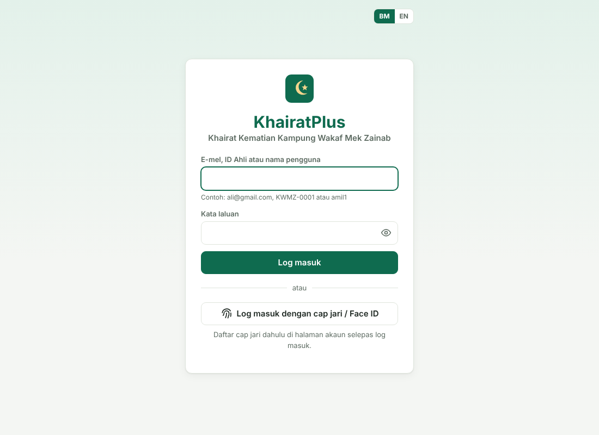
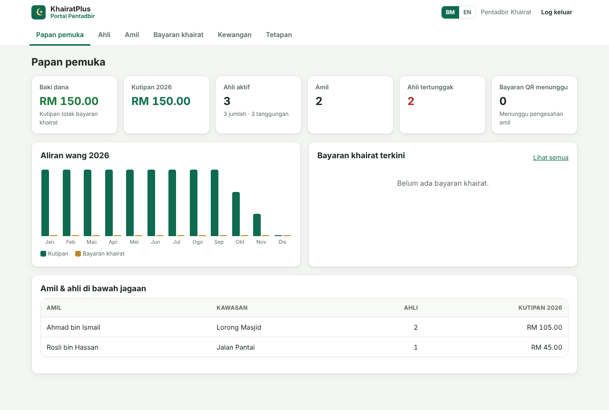
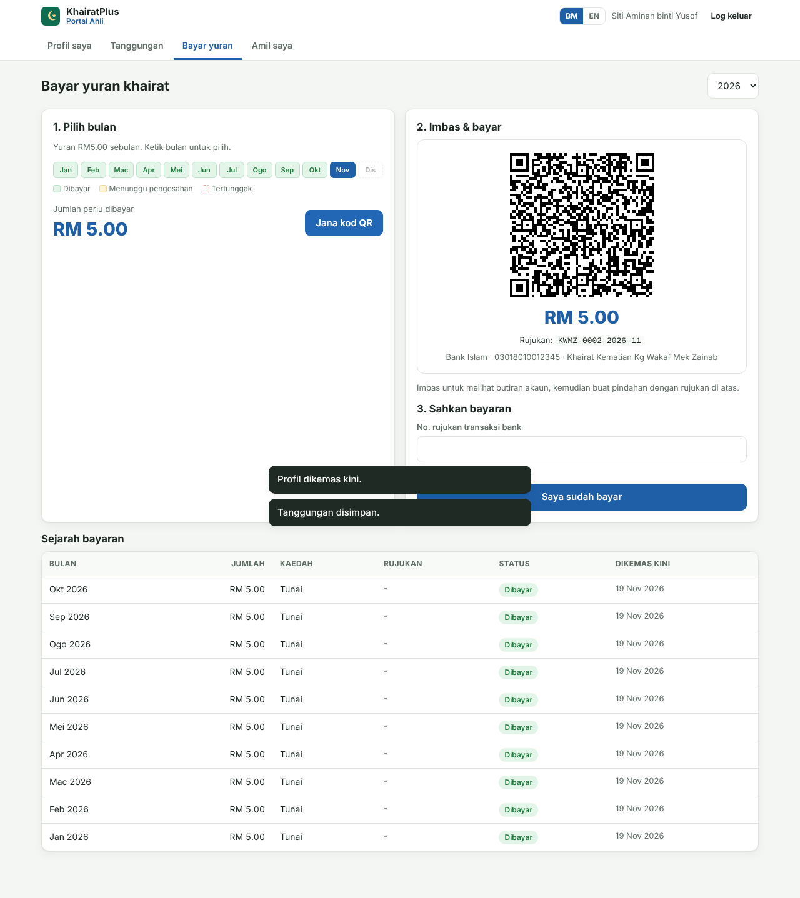
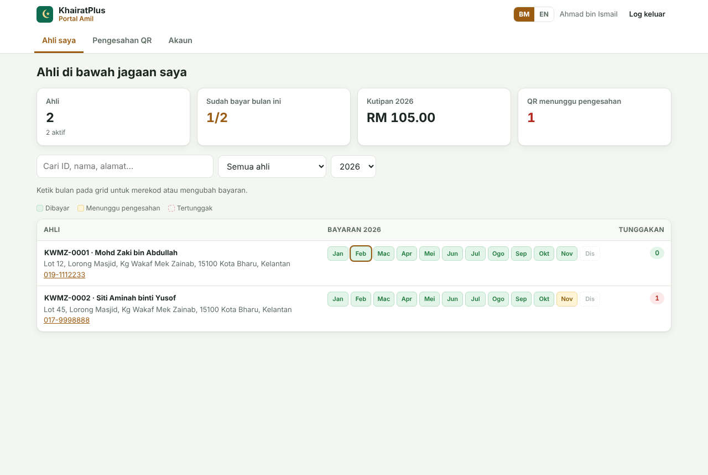

# KhairatPlus

Sistem rekod **khairat kematian** untuk penduduk **Kampung Wakaf Mek Zainab**: senarai ahli dan tanggungan, kutipan yuran bulanan oleh amil, bayaran QR, dan bayaran khairat kepada waris.

A bereavement fund app with three portals and **one login page** at the root URL. Users type their email, Member ID or username; the app reads the account's role and opens the right portal, so nobody has to pick a role:

| Portal | URL | Log masuk dengan | Boleh buat |
|---|---|---|---|
| **Pentadbir (Admin)** | `/admin` | E-mel | Tambah amil, daftar & pantau ahli, lihat profil ahli dan tanggungan, rekod kematian & bayaran khairat kepada waris, kedudukan kewangan, tetapan yuran/QR |
| **Ahli (Member)** | `/ahli` | E-mel atau ID Ahli, cth. `KWMZ-0001` | Kemas kini profil & tanggungan, bayar yuran melalui kod QR, lihat profil amil |
| **Amil (Collector)** | `/amil` | E-mel atau nama pengguna | Lihat ahli di bawah jagaan, rekod/ubah bayaran bulanan, sahkan bayaran QR |

The interface is in Bahasa Melayu with a one-tap English toggle (BM / EN).

### Logging in

- **Email + password** on the single login page. Ahli can also type their Member ID and amil their username instead of the email. The eye icon shows or hides the password.
- **Fingerprint / Face ID** (passkeys): after logging in once with a password, open the account page (*Profil saya* for ahli, *Akaun* for amil, *Tetapan* for admin) and tap *Daftar cap jari peranti ini*. From then on, *Log masuk dengan cap jari / Face ID* on the login page signs in with the phone's or laptop's fingerprint, face or screen lock. Each device is set up once, and passkeys can be removed from the same page.
- Each portal checks the role: an ahli account (or its fingerprint) cannot open the admin or amil portal, and is sent back to its own.
- **Admin → Pentadbir**: add more admins (name, email, password), reset another admin's password, or remove one (you cannot remove yourself or the last admin).




| Admin | Ahli | Amil |
|---|---|---|
|  |  |  |

## Stack

- **React 18 + Vite**, hosted on **Vercel**
- **Supabase**: Postgres database, Auth (logins), Row Level Security (each role only sees its own data), one Edge Function (`admin-users`) for the admin to create amil/ahli/admin logins
- No other server is needed (Render is not used)

## How payments work

1. The **ahli** opens *Bayar yuran*, picks the months, and taps *Jana kod QR*. If the admin uploaded the fund's official DuitNow QR in *Tetapan*, that QR is shown; otherwise the app generates a QR containing the bank account details and a payment reference (e.g. `KWMZ-0002-2026-11`).
2. After paying in their banking app, the ahli enters the bank transaction reference and taps *Saya sudah bayar*. The months show as **pending** (kuning).
3. The **amil** sees it under *Pengesahan QR*, checks the bank statement, and taps *Sahkan* (verify) or *Tolak* (reject).
4. Amil can also record cash or transfer payments directly by tapping a month in a member's 12-month grid, and edit or delete any payment of their own members.

Only **paid** (verified) payments count toward the fund balance. Balance = all collections minus all payouts.

## Setup (one time)

### 1. Supabase

1. Create a project at [supabase.com](https://supabase.com) (free tier is fine).
2. **SQL Editor → New query**: run each file in [`supabase/migrations/`](supabase/migrations/) in order (paste the whole file and **Run**): first `20261119000000_khairatplus_schema.sql` (tables, security rules, functions), then `20261119010000_member_email.sql` (member login emails). If you already ran the first file, just run the second.
3. **Authentication → Sign In / Providers → Email**: turn **off** "Confirm email" (amil and ahli use internal addresses like `kwmz-0001@khairatplus.local`, which cannot receive mail). Also turn **off** "Allow new users to sign up" so only the admin can create accounts.
4. **Passkeys (fingerprint login)**: in **Authentication**, open the **Passkeys** settings and enable them. Set the relying party ID to your site's domain without `https://` (for example `khairatplus.vercel.app`, or your own domain) and the allowed origin to the full URL (for example `https://khairatplus.vercel.app`). Passkeys are tied to that domain, so set this to the domain people will actually use; fingerprints set up on another domain won't work there.
5. **Edge Functions → Deploy a new function → Via editor**: name it exactly `admin-users`, paste [`supabase/functions/admin-users/index.ts`](supabase/functions/admin-users/index.ts), and deploy.
   (Or with the CLI: `npx supabase login`, `npx supabase link --project-ref <ref>`, `npx supabase functions deploy admin-users`.) It also handles logging in with a Member ID or username. If you deployed it before, deploy it again to get this.
6. Create the first admin: **Authentication → Users → Add user → Create new user** with your email and a password (tick *Auto Confirm User*). Then in the SQL Editor run:
   ```sql
   select public.bootstrap_admin('your-email@example.com');
   ```
7. **Project Settings → API**: copy the **Project URL** and the **anon public** key. Never put the `service_role` key in the web app or in Vercel.

### 2. Run locally

```bash
npm install
cp .env.example .env.local   # paste the Project URL and anon key
npm run dev                  # http://localhost:5173
```

### 3. Deploy on Vercel

1. Vercel → **Add New → Project** → import this GitHub repo. Framework preset: **Vite** (build `npm run build`, output `dist`).
2. **Environment Variables**: add `VITE_SUPABASE_URL` and `VITE_SUPABASE_ANON_KEY`.
3. Deploy, then attach your domain under **Settings → Domains**. `vercel.json` makes `/admin`, `/ahli` and `/amil` work on refresh.

### Optional: demo data

To try the app with sample data (2 amil, 3 ahli, payments and dependents), run this **on your own computer** against a test project:

```bash
SUPABASE_URL=https://xxx.supabase.co SUPABASE_SERVICE_ROLE_KEY=... npm run seed:demo
```

Logins: `admin@khairatplus.local` / `admin123`, amil `amil1` or `amil2` / `amil123`, ahli `KWMZ-0001` to `KWMZ-0003` / `ahli123`. Don't use these on the live project.

## Day-to-day use

- **Admin → Amil → Tambah amil**: name, phone, area, a username, an optional login email, and a password. The amil can log in with the email or the username.
- **Admin → Ahli → Daftar ahli**: the Member ID (`KWMZ-0001`, `KWMZ-0002`, …) is generated automatically. Choose the amil who looks after them, optionally add their email, and set an initial password; the app shows the login details to hand to the member.
- **Admin → Bayaran khairat → Rekod kematian & bayaran**: choose the member, then who passed away (the member or one of their dependents). The next of kin is pre-filled (spouse for a member, the member for a dependent) and the default payout amount comes from *Tetapan*. This marks the person as deceased and records the payout.
- **Admin → Kewangan**: fund balance, monthly collections vs payouts, collections per amil, and members in arrears.
- **Admin → Tetapan**: monthly fee, default payout, bank details, and the official DuitNow QR image.
- Everyone can change their own password and set up fingerprint login; the admin can reset amil and ahli passwords and change their login email from the edit form.

## Security model

Row Level Security in Postgres enforces the roles, not just the UI:

- **Ahli** see and edit only their own profile and dependents, see only their own payments and their assigned amil. They cannot change their amil, status or member ID, cannot mark payments as paid (only submit pending QR payments), and cannot mark dependents as deceased.
- **Amil** see only members assigned to them (and their dependents), and can add/edit/delete payments only for those members.
- **Admin** can see and manage everything. Account creation and password resets go through the `admin-users` Edge Function, which checks the caller is an admin.

## Project layout

```
src/
  App.jsx                 routes: login page at / and the three portals
  components/Login.jsx    single login page, sends each user to their role's portal
  components/Portal.jsx   role check, header/tabs, account security
  components/MemberDetail.jsx  shared profile / dependents / 12-month payment grid
  portals/admin/          Dashboard, Members, Amils, Payouts, Finance, Admins, Settings
  portals/ahli/           Profile, Dependents, Pay (QR), My amil
  portals/amil/           My members, QR verification, Account
  lib/i18n.jsx            BM/EN strings: t('Bahasa Melayu', 'English')
supabase/
  migrations/             database schema, RLS policies, RPCs
  functions/admin-users/  Edge Function to create logins / reset passwords
scripts/seed-demo.mjs     optional demo data
```
